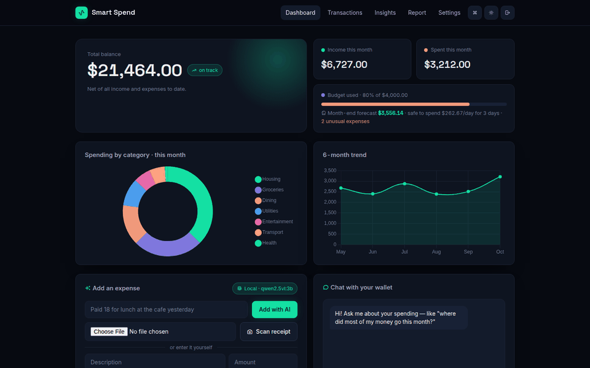
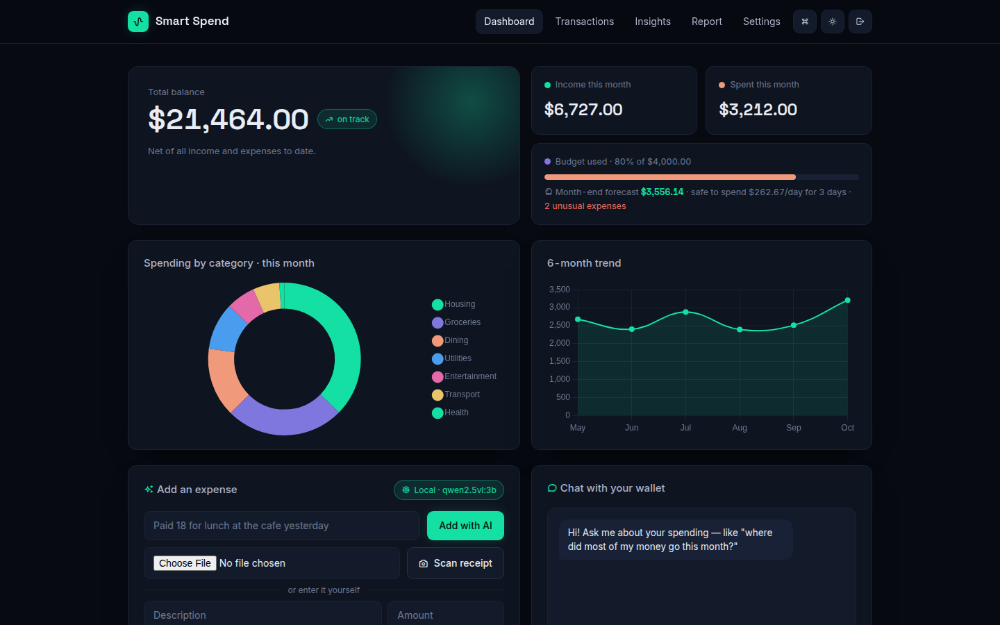
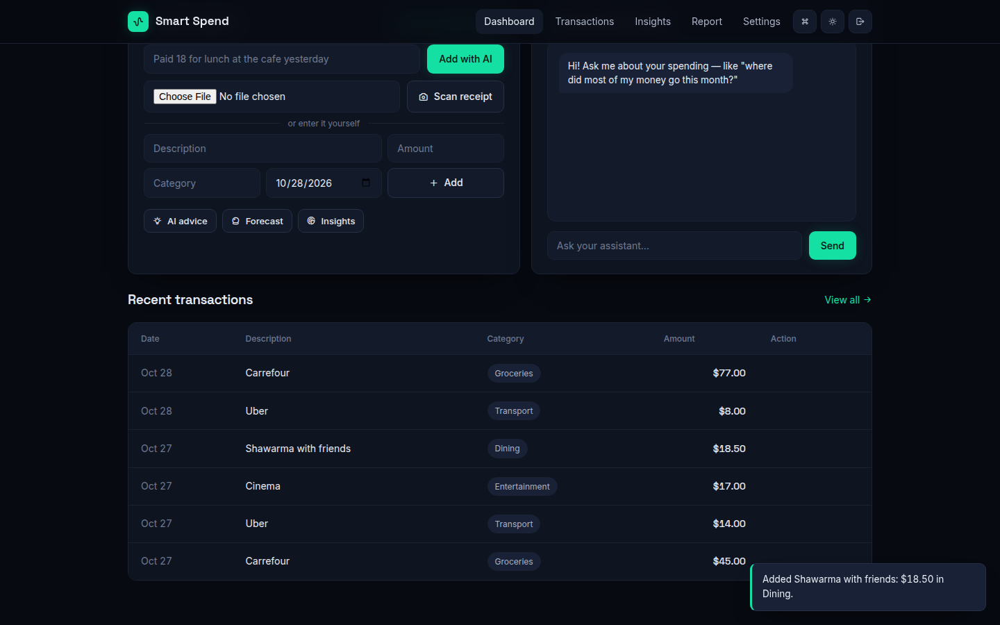
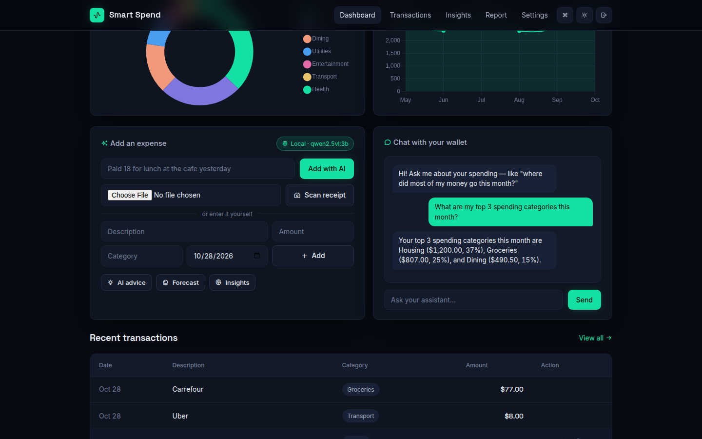
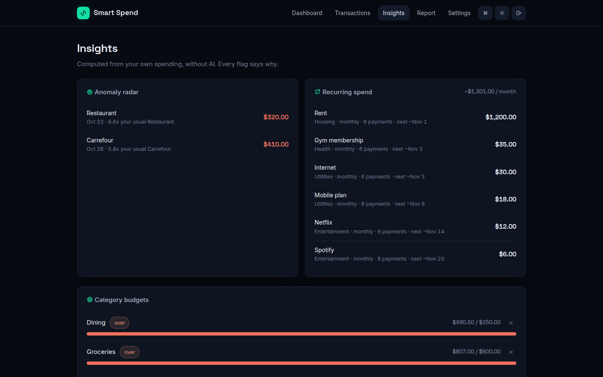
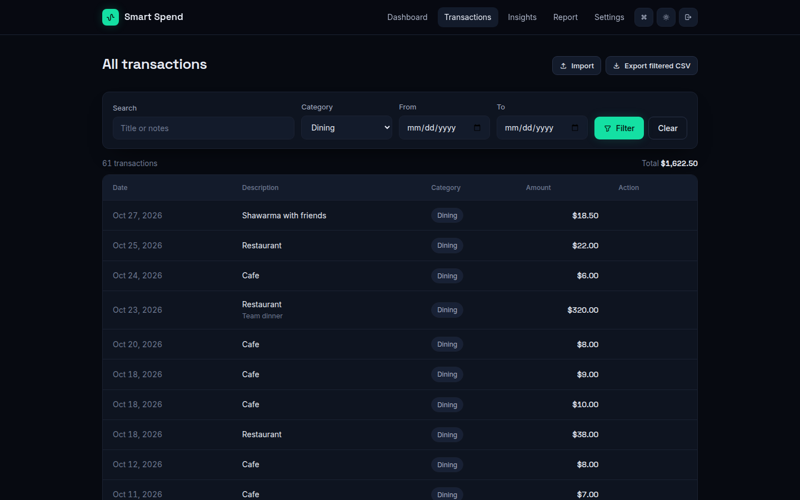
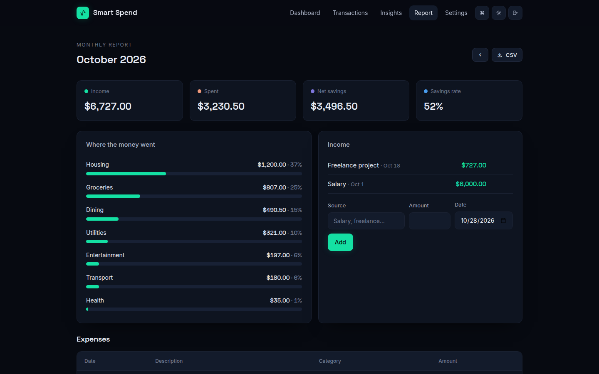
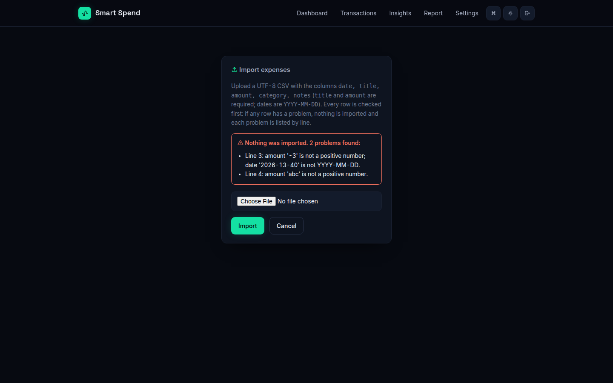

# Smart Spend

A personal finance web app that tracks spending and income, explains where the money goes, and warns before the
budget runs out. Built with Django 6.

- **The core needs no AI:** budgets, forecasts, unusual-expense alerts, subscription detection, reports and CSV
  import/export are computed from your own data. Every alert says why.
- **AI is optional, hosted or local:** type "Paid 18.50 for shawarma yesterday" or photograph a receipt, and the
  expense is filled in. Ask questions about your spending in a chat. It works with Google Gemini, or **free and
  private** with a local model through [Ollama](https://ollama.com).



## Features

**Track**
- Add expenses three ways: a manual form, one sentence of text (AI), or a receipt photo (AI).
- Income with edit and delete, and a monthly report with savings rate and spending by category.
- Transactions page with search, category and date filters, page numbers, and a total for the filtered rows.
- CSV import that checks every row first. If any row is wrong, nothing is imported and each problem is listed
  by line number. CSV export of exactly what is filtered.

**Understand** (no AI needed)
- **Month-end forecast** at your current pace, with the amount you can safely spend per day.
- **Unusual-expense radar:** compares each expense with what you normally pay **at the same merchant**, or in
  the same category for one-off merchants. Uses the median and the median absolute deviation, so one large
  purchase does not hide the next. Example: "8.6x your usual Restaurant".
- **Subscriptions and bills:** finds payments that repeat with a stable amount **at a regular interval**
  (weekly, monthly or yearly), shows the monthly total and the next expected date.
- **Category budgets** with "close" and "over" alerts, and a 6-month trend.

**Ask** (optional AI)
- Natural-language add, receipt scan, chat, advice and a reworded forecast.
- The model gets this month's numbers ranked by category, plus the top merchants, and is told to quote numbers
  as given rather than calculate new ones.
- Answers are requested as JSON matching a schema (Gemini and Ollama both support this). Amounts are then
  checked: zero, negative or unreadable values create nothing, and a date in the future becomes today.

**Experience:** dark and light themes, a command palette (Ctrl/⌘ K), and display in USD, JOD (3 decimals) or
SAR.

## Screens

| Dashboard: balance, budget, month-end forecast, alerts | AI quick add: one sentence becomes an expense |
|---|---|
|  |  |
| **Chat with your wallet (local model)** | **Insights: unusual expenses and monthly bills** |
|  |  |
| **Transactions: search, filter, total, export** | **Monthly report with savings rate** |
|  |  |
| **CSV import: all-or-nothing, errors by line** | |
|  | |

The screenshots come from the demo account with the local model `qwen2.5vl:3b` on a laptop CPU, taken
automatically by `scripts/screenshots.py`.

## Run it

Requires Python 3.11+.

```bash
make setup     # virtualenv, dev dependencies, database
cp .env.example .env
make demo      # demo account: demo@smartspend.app / demo1234
make run       # http://127.0.0.1:8000
```

With Docker: `docker compose up --build` → http://localhost:8004. Then load the demo account with
`docker compose exec web python manage.py seed_demo`.

### Turning on AI (optional)
Set one provider in `.env`:

```bash
# Hosted
GEMINI_API_KEY=your-key

# Or local and free (no data leaves your machine)
OLLAMA_URL=http://localhost:11434
OLLAMA_MODEL=qwen2.5vl:3b        # first: ollama pull qwen2.5vl:3b
```

`AI_PROVIDER` can force `gemini`, `ollama` or `none`. Without a provider, the AI buttons are disabled with a
short message, and everything else works. The active provider is shown on the dashboard.

**What to expect from the local model:** `qwen2.5vl:3b` on a laptop CPU, with no graphics card, takes about
10–15 seconds per request. It reads expenses well. In testing it turned "Paid 18.50 for shawarma with friends
yesterday" into the right title, amount, category and date. It is weak at arithmetic. Before the prompt told it
not to calculate, it reported wrong percentages and once ranked categories in the wrong order. For advice and
chat, a larger model or Gemini is the better choice.

## Engineering

- **Tests:** 48 tests, coverage 89% (`make coverage`). They cover access control between users, every
  validation rule, CSV import/export round trip, the analytics, and the AI paths, with the provider replaced by a
  stub, so no key, model or network is needed.
- **CI** (GitHub Actions): ruff lint and format check, missing-migration check, tests with a coverage floor of
  85%, and `manage.py check --deploy` with production settings.
- **Data rules in the database:** amounts must be positive (a check constraint, not just form validation).
- **Security:**
  - all data is scoped to the signed-in user
  - sign-up uses Django's password validators
  - logout and every state-changing action are POST requests with CSRF protection
  - "next" redirects are limited to this site
  - uploads have size and type limits, and images are re-encoded before they go to a model
  - with `DEBUG=False`: secure cookies, HSTS and SSL redirect; WhiteNoise serves the static files
- **Production:** Docker image on gunicorn as a non-root user, with the SQLite database on a volume.

## Project structure

```
smart_spend/          settings (all from environment variables), urls, wsgi
expenses/
  models.py           Category, Expense, Income, UserProfile, CategoryBudget, ChatMessage
  views.py            views; shared amount/date validation; CSV import/export
  services.py         analytics: trend, forecast inputs, unusual expenses, recurring bills, budgets
  ai_utils.py         provider layer (Gemini / Ollama), prompts, JSON-schema answers, deterministic forecast
  money.py            currency display (no exchange-rate conversion)
  management/commands/seed_demo.py
  static/ templates/  hand-written CSS design system and page templates (no UI framework)
scripts/screenshots.py
```

## Limitations

- Currency is for display only. There is no exchange-rate conversion between currencies.
- SQLite is fine for one person or a small group. Larger use should move to PostgreSQL.
- The unusual-expense radar needs at least 4 past expenses at a merchant, or in a category, before it can judge.
- Email uniqueness is checked at sign-up, not enforced by the database. Django's default user model is used.

## License

MIT. See [LICENSE](LICENSE).
